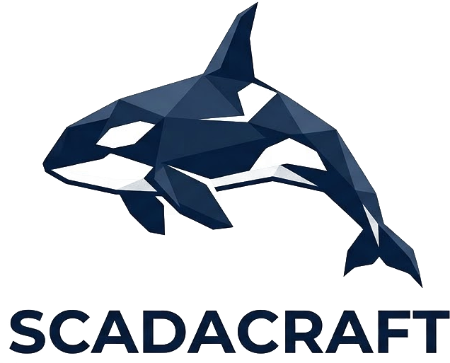

<p align="center">
  
</p>

# ScadaCraft

[](https://github.com/inferis995/scadacraft/actions/workflows/ci.yml)
[](LICENSE)

Web-based SCADA/HMI platform for industrial automation, with AI-assisted page building.

ScadaCraft is a fork of [FUXA](https://github.com/frangoteam/FUXA) by frangoteam, extended with:

- **OpenBridge widget libraries** — 49 widgets from the OpenBridge design system in five editor libraries: P&ID equipment and pipes on a 24 px grid, instruments, live charts, operator controls and alerts, all bindable to tags ([guide](docs/openbridge.md), [widget reference](docs/openbridge-widgets.md))
- **AVEVA Custom Widgets** — import `.cwp` packages from the editor or the MCP: the HTML page runs unchanged, every property of the widget becomes a variable you bind to a tag in the property panel ([guide](docs/HowTo-Widgets.md#aveva-custom-widgets-cwp))
- **MCP server** — an AI assistant manages the whole project as the UI does: devices and tags (Modbus, S7, OPC UA, MQTT, …), alarms, pages with OpenBridge and imported widgets, trend charts, live and historical data, export/import, layout and menu, users, scripts, reports, settings and backups ([mcp/](mcp/README.md))
- **Scheduled backups** — project, settings and history database, with retention and restore on restart

## Drivers

Modbus RTU/TCP, Siemens S7, OPC UA, MQTT, BACnet, EtherNet/IP, Omron, Melsec, ADS, ODBC, Redis, HTTP and more (inherited from FUXA).

## Quick start

```bash
# server
cd server && npm install && npm start
# client (dev)
cd client && npm install && npm start
```

Docker:

```bash
docker compose up --build
```

Then open `http://localhost:1881`. Images are published to `ghcr.io/inferis995/scadacraft` on version tags.

GitHub Actions (CI, docs site, Docker image) run only while the repository is public; on a private
copy run the tests locally: start the server, then `cd mcp && npm test`.

## Documentation

- [OpenBridge design and usage guide](docs/openbridge.md) and [widget reference](docs/openbridge-widgets.md)
- [MCP server](mcp/README.md) — install, configuration, tools, safety, tests
- [Creating widgets](docs/HowTo-Widgets.md)
- The FUXA guides in [docs/](docs/index.md) apply to ScadaCraft unchanged
- [Changelog](CHANGELOG.md)

## Credits and license

ScadaCraft is based on FUXA, Copyright (c) 2019-2025 frangoteam, released under the MIT License.
The original license is kept in [LICENSE](LICENSE); see [NOTICE](NOTICE) and the original
FUXA documentation in [docs/FUXA-README.md](docs/FUXA-README.md).

"FUXA" is the name of the upstream project; ScadaCraft is not affiliated with or endorsed by frangoteam.
