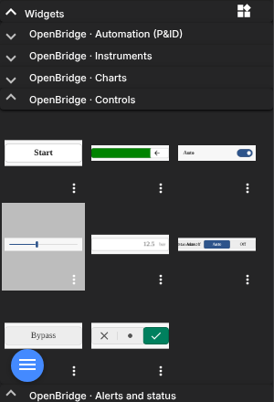
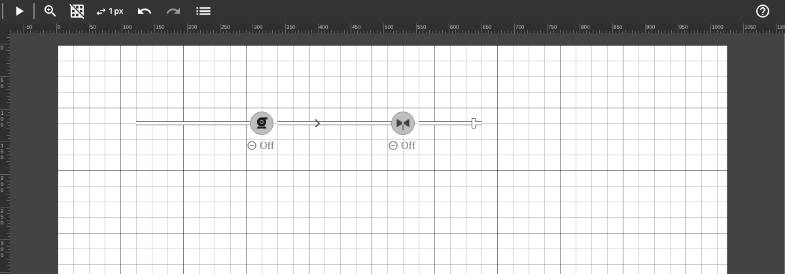
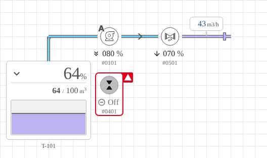
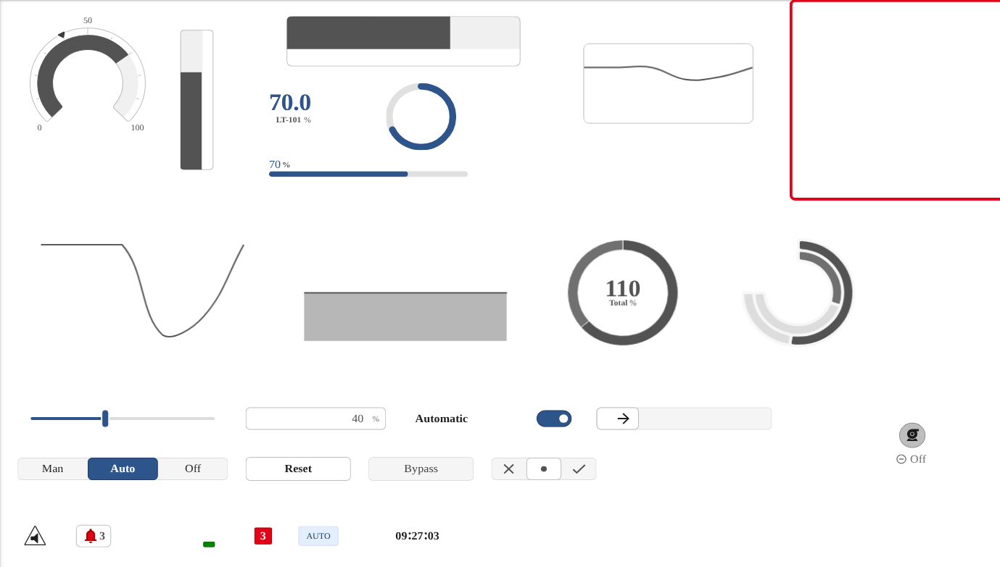

# OpenBridge in ScadaCraft — design and usage guide

ScadaCraft uses the [OpenBridge](https://www.openbridge.no) design system for its HMI
widgets: process graphics (pumps, valves, tanks, readouts, pipes), instruments, charts,
operator controls and alerts, drawn to a common industrial HMI standard.
This guide explains how the components are placed, connected, bound to tags and themed.
The full list of widgets and properties is in the generated
[widget reference](openbridge-widgets.md).

## 1. What is included

| Item | Location |
| --- | --- |
| OpenBridge web components used by the widgets (version in `VERSION`) | `client/src/assets/lib/openbridge/` |
| ScadaCraft fixes on top of OpenBridge | `client/src/assets/lib/openbridge/scadacraft-openbridge.css` |
| Editor widgets, one library group per OpenBridge category | `server/_widgets/openbridge*/*.svg` |
| Library title, order and item names (read by the editor) | `server/_widgets/openbridge*/group.json` |
| Machine-readable catalog (used by tooling and the MCP server) | `server/_widgets/openbridge/widgets.json` |
| Build and generation tools | `tools/openbridge/` |

The editor's **Widgets** panel shows five libraries, split the way OpenBridge splits its
components:

| Library | Folder | Widgets |
| --- | --- | --- |
| **OpenBridge · Automation (P&ID)** | `openbridge` | pump, motor, fan, on/off valve, control valve, damper, filter, converter/drive, transformer, breaker/switch, power source, ground, tank, readout; horizontal and vertical pipe, elbow, tee, cross (junction), crossover (no junction), pipe end, flow arrow |
| **OpenBridge · Instruments** | `openbridge-instruments` | radial gauge, vertical and horizontal bar gauge, trend gauge, instrument field, circular progress, progress bar |
| **OpenBridge · Charts** | `openbridge-charts` | live line graph, live area graph, pie chart, donut chart, radial bar chart |
| **OpenBridge · Controls** | `openbridge-controls` | command button, start/stop switch, toggle switch, setpoint slider, number input, mode selector (3 options), check button, OK/NOK selector |
| **OpenBridge · Alerts and status** | `openbridge-alerts` | alert icon, alert button with counter, alert frame, status indicator, badge, tag label, clock |



Not included: augmented-reality components and maritime navigation instruments (compass,
rudder, thrusters, wind…), which have no use in plant automation.

## 2. Licensing

OpenBridge publishes each release under **AGPL-3.0-only for 180 days**, after which that
release is also available under **Apache-2.0**. A commercial license is available to members
of the OpenBridge Joint Industry Project.

ScadaCraft ships **OpenBridge 1.0.0**, published as Apache-2.0 on 2026-04-16 and past its
change date. Do not bump the version unless the new release is past its change date or a
commercial license is in place. The license text and notice are in
`client/src/assets/lib/openbridge/`.

## 3. The placement model

OpenBridge defines a *P&ID anchor point model* for process graphics. ScadaCraft follows it
exactly for the Automation library. Widgets of the other libraries are not part of the pipe
network: they are placed by their **top-left corner** on a grid node and **fill their box**,
so they can be resized freely (keep the box on whole cells for a tidy layout).

### 3.1 Grid

The canvas uses a **24 px grid**. Every point where a pipe connects to something is a
**grid node** `(x, y)` at pixel `(x × 24, y × 24)`.

In the editor, the **grid button** switches on the P&ID grid: cells of 24 px, a major line
every 4 cells, and snapping on 24 px (also applied when a widget is dropped on the canvas).
The keyboard move step can also be set to 24.



### 3.2 Anchors

Each component has an anchor: the point that must sit on a grid node.

| Component | Anchor |
| --- | --- |
| Pump, motor, fan, on/off valve, control valve, damper, filter, converter, transformer, breaker, source, ground | Centre of the icon |
| Tank | Top-centre of the tank body |
| Readout | End of the connection tick |
| Horizontal / vertical pipe, flow arrow | Start of the pipe axis (left end / top end) |
| Elbow, tee, cross, crossover, pipe end | Centre of the fitting |

Every widget box is a multiple of 24 px, and its anchor lies at a multiple of 24 px inside the
box. So **a widget whose box is snapped to the grid always has its anchor on a node.**

To place a widget with its anchor on node `(x, y)`:

```
left = x × 24 − anchor.x
top  = y × 24 − anchor.y
```

The anchor of every widget is listed in the [reference](openbridge-widgets.md) and in
`widgets.json`.

### 3.3 Sizes

- Devices (pump, motor, fan, valves and the other equipment) have an icon of **one cell radius**: the icon covers
  the node and half of each neighbouring cell. Readouts, badges and the ID tag are drawn
  around it inside the 120 × 120 box.
- The tank body is 168 px wide (7 cells), centred on its anchor.
- Straight pipes are `length × 24` px long. Elbows, tees and crosses have arms of half a cell.

## 4. Composing a P&ID

### 4.1 Rules

1. Put each device on a node.
2. Run pipes along grid lines only, from node to node.
3. A straight pipe that ends at a device stops **one node before** the device's anchor; the
   next pipe starts **one node after** it. The device icon fills the gap.
4. Change direction with an **elbow** placed on the turning node.
5. Join three or four pipes with a **tee** or **cross**. Where two pipes pass over each other
   without connecting, use a **crossover**.
6. Use a **flow arrow** (one cell) on straight runs to show the direction of flow.
7. Terminate open lines with a **pipe end**.
8. Put a **readout** on a pipe: anchor on the pipe node, `_ps_position` = side where the
   value is shown (`top` puts it above the pipe, with the tick pointing down to it).

### 4.2 Example

A tank feeding a pump, a control valve and a discharge line (nodes in grid units):



| Item | Widget | Anchor node | Settings |
| --- | --- | --- | --- |
| Tank T-101 | `ob-tank` | (4, 5) | fluid `waste` |
| Riser from the tank top | `ob-line-vertical` | (4, 3) | length 2 (box height 48) |
| Elbow | `ob-line-elbow` | (4, 3) | direction `bottom-right` |
| Suction line | `ob-line-horizontal` | (4, 3) | length 4 → ends at (8, 3) |
| Pump P-101 | `ob-pump` | (9, 3) | |
| Discharge line | `ob-line-horizontal` | (10, 3) | length 3 → ends at (13, 3) |
| Flow arrow | `ob-line-flow` | (11, 3) | |
| Control valve FCV-501 | `ob-valve-analog` | (14, 3) | |
| Outlet line | `ob-line-horizontal` | (15, 3) | length 4 |
| Line end | `ob-line-end` | (19, 3) | direction `right` |
| Flow readout | `ob-readout` | (17, 3) | position `top`, unit `m3/h` |

### 4.3 Stretching pipes

Straight pipes follow their widget size: resizing a horizontal pipe in the editor changes
its length in whole cells (`round(width / 24)`), it does not scale the drawing. Keep pipe
boxes at multiples of 24 px. The other P&ID symbols have a fixed size and should not be
resized. Instruments, charts, controls and alerts re-lay out to any box size (charts and
gauges redraw at the new size, buttons and switches take the box width).

## 5. Binding to tags

Widget properties appear in the property panel. Bind each one to a tag, or leave it unbound
and set a fixed value.

| Prefix | Type | Tag value accepted |
| --- | --- | --- |
| `_pb_` | boolean | `true/false`, `1/0`, `"on"` |
| `_pn_` | number | any number or numeric string |
| `_ps_` | string | text |

**Commands.** Pumps, motors, fans and on/off valves have a `_pb_command` property. Clicking
the symbol writes `1` (start/open) or `0` (stop/close) to the bound tag, computed as the
opposite of the current feedback (`_pb_running` or `_pb_open`). The symbol only changes
when the feedback tag changes, so the operator always sees the real state of the equipment.

Pumps, motors, fans, on/off valves, dampers, converters and breakers work this way.

**Operator controls** (Controls library) are read/write: the same property shows the tag and
is written when the operator acts, so a setpoint or a mode needs a single binding.

| Widget | Property (read/write) | Written when |
| --- | --- | --- |
| Command button | `_pn_command` (write only) | click: writes `_pn_pressValue` (default 1) |
| Start/stop switch | `_pb_running` | the handle is slid to the other end (1/0) |
| Toggle switch | `_pb_value` | toggled (1/0) |
| Setpoint slider | `_pn_value` | dragged (debounced, 250 ms) |
| Number input | `_pn_value` | Enter or leaving the field; Esc cancels |
| Mode selector | `_pn_value` | an option is selected (0, 1, 2) |
| Check button | `_pb_value` | clicked (1/0) |
| OK/NOK selector | `_pn_value` | a state is selected (0 none, 1 OK, 2 NOK) |

While the operator acts, values coming from the tag are ignored for about one second, so the
control does not jump back before the PLC confirms the new value. The alert button writes
`_pb_command` = 1 on click (e.g. a silence or acknowledge request in the PLC).

**Live charts.** The line graph, area graph and trend gauge keep a rolling buffer of the
bound value in the browser: the value is sampled every `_pn_interval` seconds (default 1)
and the last `_pn_points` samples are drawn (default 60, the last minute). The buffer starts
empty when the page opens; for historical trends use the ScadaCraft chart control with DAQ.

**Status codes.** The status indicator takes a number (`0` inactive, `1` active, `2` running,
`3` caution, `4` warning, `5` alarm), easy to map from a PLC integer.

**Typical binding for a pump:**

| Property | Tag example |
| --- | --- |
| `_pb_running` | `P101.RunFeedback` |
| `_pb_command` | `P101.StartStopCmd` |
| `_pb_alarm` | `P101.Fault` |
| `_pb_auto` | `P101.AutoMode` |
| `_pn_speed` | `P101.SpeedPct` |
| `_ps_tag` | fixed `101` |

## 6. Fluids, media and line types

- **Pipe medium** (`_ps_medium`): `normal`, `water`, `air`, `empty`. `empty` draws a hollow
  pipe, useful for lines out of service.
- **Fluid colour** (`_ps_fluid`): colour from the OpenBridge medium palette, for tanks and
  for pipes whose medium is `water` or `air`: `fresh-water`, `sea-water`, `waste`, `masses`,
  `fuel`, `oil`, `steam`, `hot`, `cold`, `air-ventilation`, `acid-alkalis`, `fire-fighting`,
  `flammable-gas`, `non-flammable-gas`. Leave empty for the default colour.
- **Line type** (`_ps_lineType`): `fluid` (process pipe), `electric`, `air` (duct),
  `connector` (signal line).

For water and wastewater plants: `fresh-water` for potable and treated water, `waste` for
raw sewage, `masses` for sludge, `air-ventilation` for blowers and aeration air.

## 7. Themes, font and alarm colours

**Palette.** OpenBridge has four palettes: `day`, `dusk`, `night` (control rooms with low
lighting) and `bright` (sunlight). Choose it in the editor: *Layout → OpenBridge widget
palette* (previewed while the dialog is open), or with the MCP server:
`scadacraft_set_layout {"openbridge_theme": "night"}`. Every OpenBridge widget, on every page
and in the editor, follows it (it sets `data-obc-theme` on `<html>`). Through the MCP the page
backgrounds follow too (`page_background`, default on): pages with a white or palette
background take the palette's container colour (day `#F7F7F7`, dusk `#1F1F1F`, night `#000000`,
bright `#FCFCFC`); pages with a custom colour are left alone.

**Font.** The components use Noto Sans (`--font-family-main`), shipped in
`client/src/assets/lib/openbridge/NotoSans.ttf` (SIL Open Font License) and loaded by
`scadacraft-openbridge.css`.

**Alarm colours.** New alarms use the OpenBridge alert palette (day), in the editor and
through the MCP server:

| ScadaCraft level | OpenBridge alert | Background | Text |
| --- | --- | --- | --- |
| High-High | Alarm | `#E30019` | `#FFFFFF` |
| High | Warning | `#FE9413` | `#1A1A1A` |
| Low | Caution | `#FFDB42` | `#3D3D3D` |
| Info | Notification | `#1D3C67` | `#FFFFFF` |

**Alarm status tags.** `scadacraft_create_alarm_status_tags` adds server tags that ScadaCraft
keeps equal to the alarm engine's counts: `Alarms Active`, `Alarms Unacknowledged`,
`Alarms HighHigh`, `Alarms High`, `Alarms Low`, `Alarms Info`, `Alarms Total`. Bind them to
the Alerts library: alert button count = *Unacknowledged*, alert icon and alert frame
active = *HighHigh*, badge number = *Active*.

## 8. Known limitations of OpenBridge 1.0.0

| Limitation | ScadaCraft handling |
| --- | --- |
| Device ID tag is numeric only (shown as `#NNNN`) | `_ps_tag` takes a number; tank labels are free text |
| Pipes read `--automation-fresh-water`, which the palette does not define (also in 2.x) | Defined in `scadacraft-openbridge.css` from the palette's fresh-water colours |
| Tank ignores `medium` and always uses the fuel colour | Widget sets the fill from `_ps_fluid` |
| Badges are booleans (`badgeAuto`, …); 2.x uses enums | Widgets expose booleans |
| Bar gauges draw no scale labels in 1.0.0 | Use an instrument field or readout next to the gauge for the value |
| Horizontal bar gauge reserves space for a scale below the bar | Widget draws it at its native 384 × 72 and scales it to the box |
| The slider does not jump to a clicked position (no seeking) | Drag the thumb; the enhanced variant adds −/+ buttons |
| The radial gauge logs a harmless `<path> … NaN` console error at first render | None needed, the gauge renders correctly |

## 9. Editor library previews

The editor shows library items as images, where scripts and web components do not run.
Each widget therefore embeds a static preview rendered from the real component
(`tools/openbridge/make-previews.mjs`), in the state listed under `preview` in the catalog.
Non-P&ID widgets are rendered on the OpenBridge panel colour so they stay readable on the
dark library panel. The preview is removed as soon as the widget runs on a page.

## 10. Maintenance

```bash
cd tools/openbridge && npm install        # once: esbuild + playwright

# rebuild the OpenBridge bundle (components listed in entry.js)
npm run bundle

# regenerate widgets, library previews, widgets.json and docs/openbridge-widgets.md
npm run widgets
```

When upgrading OpenBridge: check the license change date, rebuild the bundle, re-measure
the anchors (component offsets may change between versions), regenerate the widgets and
re-run the visual check. Rebuild the client afterwards (`client/dist` is versioned).

## 11. For the MCP server and other tools

`server/_widgets/openbridge/widgets.json` describes the libraries (`categories`) and every
widget: file, library, layout (`anchor` for P&ID symbols, otherwise top-left anchored and
resizable), OpenBridge element, box size, anchor, stretch axis and properties (name, type,
default, direction `read`/`write`/`rw`). A tool that places a widget on node `(x, y)` computes
the position with the formula in §3.2, sets the box size (stretch widgets: `cells × 24` on the
stretch axis; resizable widgets: any whole number of cells) and binds properties by name.
The ScadaCraft MCP server ([mcp/](../mcp/README.md)) implements this: `scadacraft_list_widgets`
lists the libraries, `scadacraft_place_widgets` places widgets by node (with `size` in cells
for resizable widgets) and `scadacraft_draw_pipe` turns a path of nodes into pipes and elbows.




## OpenBridge icons

The about 2000 icons of the OpenBridge design system (alerts, automation, equipment, navigation,
weather, arrows…) are available wherever ScadaCraft shows an icon: side menu items, header buttons,
page buttons and map markers. In the editor, open the icon picker and type part of the name (for
example `pump`, `alarm`, `tank`); OpenBridge icons are listed first. Their name is `ob:<name>`
(`ob:alerts`, `ob:tank`, `ob:location-1`), which can also be typed or set through the MCP
(`scadacraft_list_icons` searches them). The icons take the text colour of the menu or button.
