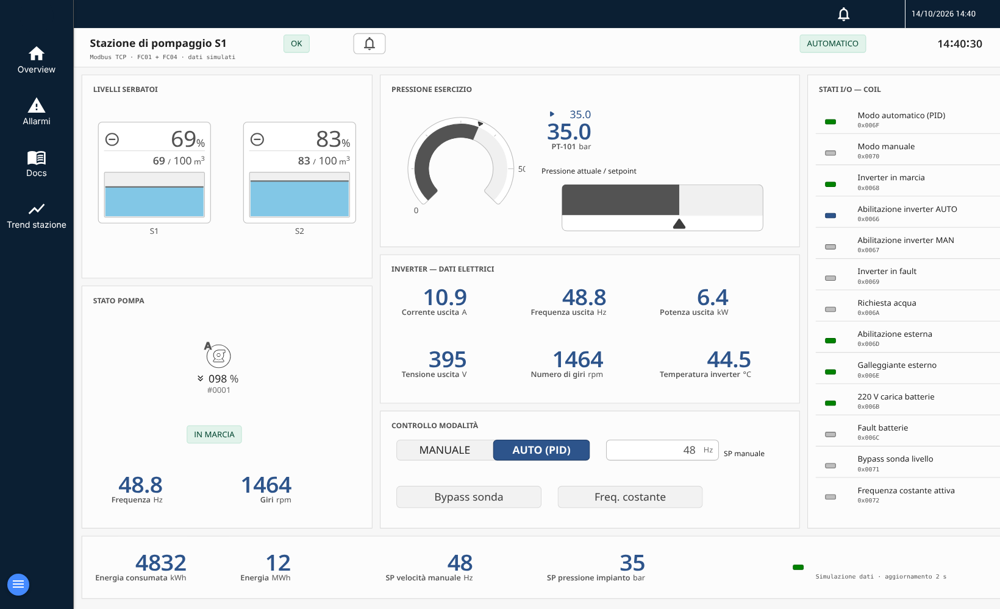

# scadacraft-mcp-server

MCP server for [ScadaCraft](../README.md). It gives an AI assistant (Claude or any MCP client)
the whole project of a running ScadaCraft server, as the UI does: devices and tags, alarms,
pages with OpenBridge widgets and imported widgets, trend charts, live and historical data,
export and import, and the application itself (layout, menu, logo, colours and OpenBridge
palette, settings and history database, users, scripts, notifications, languages, reports,
API keys, logs, backups).

Everything is written in the same format as the ScadaCraft editor, so devices, alarms and
pages created through MCP appear, run and can be edited by hand like any other.

## Tools (91)

**Project**

| Tool | What it does |
| --- | --- |
| `scadacraft_get_project_summary` | Views, devices, tags, alarms, scripts at a glance |
| `scadacraft_export_project` | Save the project to a JSON file (same as "Save Project As") |
| `scadacraft_import_project` | Merge selected views/devices/alarms from a file, or replace the whole project (backup first) |

**Devices and tags**

| Tool | What it does |
| --- | --- |
| `scadacraft_list_devices` | Devices with connection settings, tag count and live connection status |
| `scadacraft_create_device` | Modbus TCP/RTU, Siemens S7, OPC UA, MQTT, BACnet, EtherNet/IP, … |
| `scadacraft_update_device` | Enable/disable, rename, polling, connection settings |
| `scadacraft_delete_device` | Delete, listing views/alarms that used its tags |
| `scadacraft_list_tags` | Tags of all devices with their `Device.Tag` reference |
| `scadacraft_add_tags` | Tags with driver addresses (`40001`, `DB1,REAL0`, OPC UA node ids, MQTT topics), scaling, history; server memory tags |
| `scadacraft_update_tags` | Rename, address, type, scaling, decimals, history logging, deadband |
| `scadacraft_delete_tags` | Delete, listing remaining references |
| `scadacraft_list_drivers` | Optional driver packages and whether they are installed |
| `scadacraft_install_driver` | Install a driver on the ScadaCraft server (`Chart`: optional canvas renderer for report charts) |

**Data**

| Tool | What it does |
| --- | --- |
| `scadacraft_read_tags` | Live values |
| `scadacraft_write_tags` | Write values — **reaches field devices** |
| `scadacraft_get_history` | History with min/max/avg, optional points and CSV file |

**Alarms**

| Tool | What it does |
| --- | --- |
| `scadacraft_list_alarms` | Alarm definitions |
| `scadacraft_set_alarm` | Create or replace an alarm: highhigh/high/low/info levels with `above`/`below`/range, text, group, delay, ack mode |
| `scadacraft_delete_alarm` | Delete a definition |
| `scadacraft_get_active_alarms` | Active and unacknowledged alarms |
| `scadacraft_ack_alarms` | Acknowledge one alarm or all |
| `scadacraft_get_alarm_history` | Alarm events in a time range |
| `scadacraft_create_alarm_status_tags` | Server tags with live alarm counts (active, unacknowledged, per level) for OpenBridge alert widgets |

**Pages**

| Tool | What it does |
| --- | --- |
| `scadacraft_list_widgets` | OpenBridge widget libraries (automation P&ID, instruments, charts, controls, alerts), anchors, properties; explains the placement model |
| `scadacraft_list_views`, `scadacraft_get_view` | Pages and their items |
| `scadacraft_create_view`, `scadacraft_update_view`, `scadacraft_duplicate_view`, `scadacraft_delete_view` | Page management |
| `scadacraft_place_widgets` | Widgets by grid node, with properties and tag bindings; `size` in cells for instruments, charts, controls and alerts |
| `scadacraft_draw_pipe` | Pipe along a path of nodes, elbows at bends |
| `scadacraft_set_properties` | Change values or bindings of a placed widget |
| `scadacraft_draw_shapes` | Cards, titles, labels and separators (plain editor shapes); colours can follow the OpenBridge palette (`ob:container-global`, `ob:element-active`, …) |
| `scadacraft_remove_items` | Remove items or shapes from a page |
| `scadacraft_set_events` | Click / mouse events on any item (widget, chart, value, button, shape): open a page, a popup or a floating card, close it, write / add to / toggle a tag, run a script, open a link |
| `scadacraft_animate_shape` | Shape animation from tags: colour by value range, blink, hide/show, rotate by value, spin, move |
| `scadacraft_place_value` | Native value display: tag value with unit and decimals |
| `scadacraft_place_button` | Native button with its events (and background colour by tag value) |
| `scadacraft_place_chart` | ScadaCraft trend chart on a page, bound to a chart definition (realtime window or history with time toolbar) |
| `scadacraft_create_trend_page` | One step: chart definition with the tags, a page with the chart filling it, menu entry |

**Widget library**

| Tool | What it does |
| --- | --- |
| `scadacraft_list_library_widgets` | Groups and widgets of the editor's Widgets panel; describe one widget (size, properties) |
| `scadacraft_import_widgets` | Import native FUXA/ScadaCraft SVG widgets (files, folders or inline SVG) and AVEVA Custom Widget packages (`.cwp`) into a library group |
| `scadacraft_remove_library_widgets` | Remove imported widgets from the library |

Imported widgets are placed with `scadacraft_place_widgets` using `"group/file"` as widget name,
top-left on the node, with `size` in cells and properties bound like the OpenBridge ones.
Chart pens (tags, labels, colours, Y axes) are defined with `scadacraft_set_chart`.

Resources: `scadacraft://docs/openbridge` (design and usage guide) and
`scadacraft://docs/openbridge-widgets` (widget reference).

Times accept ISO 8601, epoch ms, or relative values such as `-15m`, `-24h`, `-7d`.

**Application**

| Tool | What it does |
| --- | --- |
| `scadacraft_get_layout`, `scadacraft_set_layout` | Start page, menu (items with sub-menus, mode, colours, logo), header (title, colours, alarms, date/time, login info, buttons / labels / icons with tags and click events), zoom, OpenBridge palette (`openbridge_theme`, page backgrounds) |
| `scadacraft_list_icons` | Search the ~2000 OpenBridge icons, used as `ob:<name>` in menu, header, buttons and map markers |
| `scadacraft_list_map_locations`, `scadacraft_set_map_location`, `scadacraft_delete_map_location` | Map markers: coordinates, icon, live tag value, page in a card, page to open, link |
| `scadacraft_set_map_page` | Map page (OpenStreetMap) with a set of locations, centre and zoom |
| `scadacraft_upload_image` | Upload a logo, icon or background image |
| `scadacraft_get_settings`, `scadacraft_set_settings` | Language, port, security, SMTP, history database (type, retention), alarm and log retention, broadcast |
| `scadacraft_send_test_mail` | Test the SMTP settings |
| `scadacraft_clear_alarm_history` | Clear the alarm history |
| `scadacraft_list_users`, `scadacraft_set_user`, `scadacraft_delete_user` | Users with groups, roles, start page, language |
| `scadacraft_list_roles`, `scadacraft_set_role`, `scadacraft_delete_role` | Roles |
| `scadacraft_list_scripts`, `scadacraft_set_script`, `scadacraft_run_script`, `scadacraft_delete_script` | Server/client scripts with parameters and scheduling |
| `scadacraft_list_notifications`, `scadacraft_set_notification`, `scadacraft_delete_notification` | Alarm e-mail notifications |
| `scadacraft_get_texts`, `scadacraft_set_languages`, `scadacraft_set_texts`, `scadacraft_delete_texts` | Languages and translated texts |
| `scadacraft_list_charts`, `scadacraft_set_chart`, `scadacraft_delete_chart` | Chart definitions (pens on tags) |
| `scadacraft_list_reports`, `scadacraft_set_report`, `scadacraft_build_report`, `scadacraft_delete_report` | PDF reports (tags table, chart, alarms), scheduled or on demand; charts are drawn without extra plugins |
| `scadacraft_list_api_keys`, `scadacraft_create_api_key`, `scadacraft_delete_api_key` | API keys |
| `scadacraft_read_logs` | Server log |
| `scadacraft_backup_status`, `scadacraft_create_backup`, `scadacraft_set_backup_schedule`, `scadacraft_restore_backup`, `scadacraft_delete_backup` | Backups of project, settings and history database; schedule, retention, restore on restart |
| `scadacraft_get_section`, `scadacraft_set_section` | Raw project sections, for anything not covered above |

## Example

`examples/stazione-pompaggio.mjs` builds a complete pumping-station page through the MCP server:
34 simulated tags, a server script that simulates the plant, alarms, a page with cards and labels
in the OpenBridge palette and 42 OpenBridge widgets (tanks, pump, pressure gauge with setpoint,
inverter values, mode selector, setpoint input, coil states), plus a trend page. Run it against
any ScadaCraft: `node examples/stazione-pompaggio.mjs`.



## Typical session

> Add a Modbus TCP PLC at 192.168.1.10 (unit 1) with the tank level in 40001 (Float32),
> pump running on coil 1 and start/stop on coil 2. Log the level. Alarm above 90 % and
> below 10 %. Then draw a page with the tank and the pump.

The assistant uses: `create_device` → `add_tags` → `update_device {enabled: true}` →
`read_tags` (checks communication) → `set_alarm` → `create_view` → `place_widgets` /
`draw_pipe` → `get_view`.

## Install and build

```bash
cd mcp
npm install
npm run build
```

Requires Node.js 20 or later and a running ScadaCraft server.

## Configuration

| Variable | Default | Purpose |
| --- | --- | --- |
| `SCADACRAFT_URL` | `http://127.0.0.1:1881` | ScadaCraft server |
| `SCADACRAFT_USERNAME`, `SCADACRAFT_PASSWORD` | — | Admin user, only if ScadaCraft security is enabled |
| `TRANSPORT` | `stdio` | `stdio` or `http` |
| `HOST`, `PORT` | `127.0.0.1`, `3001` | Listen address for `TRANSPORT=http` (endpoint `/mcp`) |
| `SCADACRAFT_MCP_TOKEN` | — | Bearer token for `TRANSPORT=http`; **required** when `HOST` is not localhost (min. 24 characters) |
| `MCP_ALLOWED_HOSTS` | — | Comma-separated `Host` names accepted by the HTTP endpoint (DNS-rebinding protection) |

### Claude Code

```bash
claude mcp add scadacraft --env SCADACRAFT_URL=http://127.0.0.1:1881 -- node /path/to/scadacraft/mcp/dist/index.js
```

### Claude Desktop

`claude_desktop_config.json`:

```json
{
  "mcpServers": {
    "scadacraft": {
      "command": "node",
      "args": ["/path/to/scadacraft/mcp/dist/index.js"],
      "env": { "SCADACRAFT_URL": "http://127.0.0.1:1881" }
    }
  }
}
```

### HTTP transport

```bash
# same machine: localhost only, Host header checked (DNS-rebinding protection)
TRANSPORT=http PORT=3001 SCADACRAFT_URL=http://127.0.0.1:1881 node dist/index.js

# on the network: a bearer token is mandatory
export SCADACRAFT_MCP_TOKEN=$(openssl rand -hex 32)
TRANSPORT=http HOST=0.0.0.0 PORT=3001 MCP_ALLOWED_HOSTS=hmi-server,hmi-server.local \
  SCADACRAFT_URL=http://127.0.0.1:1881 node dist/index.js
```

Clients send `Authorization: Bearer <token>`; requests without it get `401`. The server refuses
to listen on a non-localhost address without a token, because whoever reaches it can change the
project and write tags. Use HTTPS (a reverse proxy) when the token crosses an untrusted network,
and keep the MCP server on the OT side of the firewall.

## Safety

- `scadacraft_write_tags` and enabling a device act on real equipment. Server memory tags
  (`FUXA Server.*`) are safe for tests and simulation.
- `scadacraft_import_project` with `mode: "replace"` replaces the whole project; a backup of
  the current project is written first.
- Delete tools report the pages and alarms that still reference removed tags.
- Device passwords (OPC UA, MQTT) are stored as device security on the server, not in the
  project file, and are masked in tool results.
- Files (export, import, CSV) are read and written on the machine running the MCP server.

## Notes

- If the editor is open while the project is changed through MCP, reload the editor.
- Tag references accept `Device.Tag`, a unique tag name, or a tag id.
- Optional drivers (Modbus, S7, OPC UA, …) must be installed on the ScadaCraft server;
  `scadacraft_create_device` warns when the driver is missing and `scadacraft_install_driver`
  installs it.
- An acknowledged alarm shows as acknowledged at the next alarm check (about 1 s).

## Tests

```bash
npm test
```

- `test/parity.mjs`: widget script processing matches the editor's code for every widget.
- `test/http-auth.mjs`: HTTP transport security (token required on the network, 401 without it, DNS-rebinding protection on localhost).
- `test/e2e.mjs`: page building with server memory tags (tank, pump, valve, readout, pipes).
- `test/e2e-cwp.mjs`: AVEVA Custom Widget import (package built by the test): properties, directions and labels,
  files served, cwidget host, placement with bindings, invalid package, removal.
- `test/e2e-library.mjs`: widget import into the library, placement of imported widgets with
  bindings, trend chart on a page (history mode), one-step trend page with menu entry.
- `test/e2e-widgets.mjs`: the five OpenBridge libraries; builds the page "OpenBridge showcase" with
  every instrument, chart, control and alert bound to server tags (sizes in cells, top-left anchor).
- `test/e2e-interaction.mjs`: events (page, popup, card, close, set/add/toggle tag, script, link) on
  widgets, buttons and shapes; value display; shape colour/blink/hide animation; stored format as the editor expects.
- `test/e2e-navigation.mjs`: OpenBridge icon search, menu with OpenBridge icons and a sub-menu, header items with
  tags, colours and events, map locations and map page, unknown icon names rejected.
- `test/e2e-plant.mjs`: full plant against a simulated Modbus TCP PLC (`test/modbus-sim.mjs`):
  driver install, device, tags with scaling and history, live read, write to the PLC,
  connection status, alarm raise/acknowledge/history, tag history with CSV, page bound to
  the PLC, view update/duplicate, export, merge import and full replace.

The end-to-end tests need a running ScadaCraft (`SCADACRAFT_URL`) and skip otherwise.
`E2E_CLEANUP=1` removes what they create.
